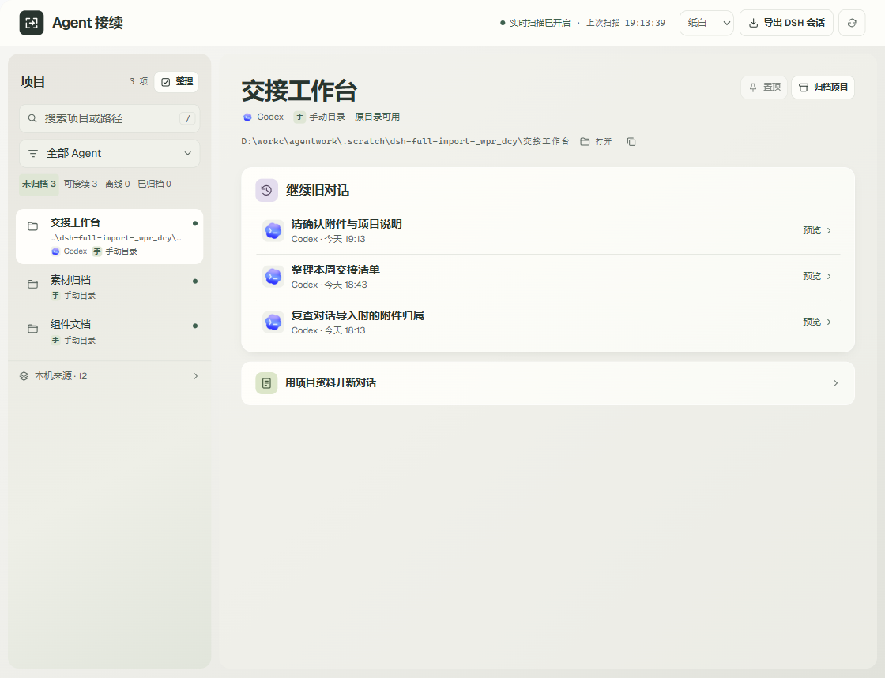

<div align="center">

# Agent Bridge

### 换个 Agent，接着做。

把本机其他 Agent 的对话、项目记忆和 Skills 带进 DeepSeek Harness，在熟悉的工作目录继续。

[下载 v0.11.0 Desktop 插件](https://github.com/wfz2006/dsh-agent-bridge/releases/download/v0.11.0/dsh-agent-bridge.tgz) · [独立 Skill](#dsh-原生-skill) · [使用指南](#使用) · [图文介绍](https://wfz2006.github.io/dsh-agent-bridge/)



</div>

## 主要功能

- **搜索正文与定位回合**。在项目内跨会话查找原文、文件名和报错，点击命中结果即可跳到来源回合。
- **预览并接续会话**。勾选早期决定或工具结果，迁入前查看带给 Agent 的续聊上下文。已迁入的对话显示上次迁入时间，可打开现有 DSH 会话或另开副本。
- **整理项目接力单**。把多条会话中的内容整理到「已决定」「已完成」「未解决」「下一步」，可编辑、回跳来源和导出 Markdown。
- **审阅分享版 Markdown**。导出前检查本机路径、邮箱、IP 地址和常见凭据，逐项决定保留或脱敏，确认最终预览后下载。
- **带入项目资料与 Skills**。核对记忆和交接草稿。技能包读取、校验、快照保存和项目级登记由 Agent Bridge 实现，原生调用通过 DSH 的 Skill 服务完成。


## 安装

### 安装 v0.11.0

在 **DSH Desktop** 的 **插件 → 安装插件** 中选择 `dsh-agent-bridge.tgz`。完全退出并重新打开 DSH，在侧栏选择 **Agent 工作接续**。 [下载 v0.11.0 插件](https://github.com/wfz2006/dsh-agent-bridge/releases/download/v0.11.0/dsh-agent-bridge.tgz)

**DSH Web**。在已安装 DSH CLI 的环境运行以下命令。

```sh
dsh plugin --profile web add @wwwfz/dsh-agent-bridge@0.11.0
dsh web
```

### 从源码构建

用 Node.js 22.13 或更高版本构建主分支。

```sh
git clone --branch main https://github.com/wfz2006/dsh-agent-bridge.git
cd dsh-agent-bridge
npm pack
```

在 DSH Desktop 的 **插件 → 安装插件** 中选择 `npm pack` 生成的 `.tgz`，完全退出并重新打开 DSH。

### DSH 原生 Skill

Agent Bridge Skill 可在 DSH 会话内按项目和来源查找旧对话，选取项目记忆并生成接续草稿或 Markdown。它通过 DSH Shell 调用随包附带的本地脚本，要求 Node.js 22.13 或更高版本。

| 在 DSH 里说 | Skill 可以完成 |
| --- | --- |
| 「接着我刚才在 Codex 里对这个项目的工作」 | 自动找最新可读会话，生成接续草稿 |
| 「找我上次做同步重试的项目和 Claude Code 对话」 | 跨项目查找，按标题筛选并分页 |
| 「看看第二轮的工具结果，把附件保存到项目」 | 分页查看来源历史，按需保存可读取的附件 |
| 「检查项目记忆和那个 Skill 的脚本，把选中的资料导出」 | 查看资料、核对 Skill 文件，导出本机版或分享版 Markdown |
| 「把这个项目置顶」 | 置顶、取消置顶、归档和恢复，和插件使用同一份项目状态 |

独立 Skill 的 `handoff --format share` 和 `history --format share` 默认脱敏正文和随文导出的工具结果。需要逐项决定保留哪些内容时，可在插件侧栏打开「审阅分享版」。Skill 和插件可同时使用。 [Skill 完整用法](skills/agent-bridge/references/commands.md)

将独立 Skill 0.3.1 的 ZIP 解压到项目的 `.dsh/skills/agent-bridge/`，或 DSH 用户目录的 `skills/agent-bridge/`，确保 `SKILL.md` 和 `scripts/` 位于同一级。打开该项目的 DSH 会话，选择 **agent-bridge**，例如「看看这个项目在 Codex 里上次做到哪里，生成接续草稿」。 [下载独立 Skill](https://github.com/wfz2006/dsh-agent-bridge/releases/download/v0.11.0/agent-bridge-skill-0.3.1.zip)

维护者可以在仓库用 `npm run build:skill -- .local/skill-release` 生成 `.local/skill-release/agent-bridge/`。打包市场 ZIP 时，把生成目录的 `SKILL.md`、`scripts/`、`references/` 和第三方声明放在 ZIP 根目录。

## 使用

### 迁入旧对话

1. 在项目列表中按名称、路径或 Agent 查找项目。
2. 打开最近对话，或在对话搜索中选「正文」。点击搜索结果可直接跳到来源回合。
3. 在完整历史中勾选「带入续聊」，可跨对话收集早期约束和关键结果。打开「Agent 将收到的续聊上下文」，核对近期问答和勾选内容。
4. 选择 **迁入并继续**。原目录离线时可选择新的本机目录。迁入后在 DSH 会话头部打开 **来源记录**，按回合查看正文、过程和附件。

已迁入的对话会显示上次迁入时间，默认打开最近一份仍可用的 DSH 会话。同一 Codex 配置和项目内，带原生会话 ID 的日志从活动目录移入归档后，仍可打开原 DSH 会话，接力单也可跳回原回合。选择「另开副本」可先预览，再创建独立会话。早期版本保存的时间以「约」标出。

若迁入失败，插件确认 DSH 尚未开始写入时，会提供「重新选择迁入目录」。选好目录后可再次核对原先的摘录，再确认迁入。若 DSH 已开始写入，重试会继续使用原来的会话。

### 用项目资料开新对话

展开 **用项目资料开新对话**，选择项目记忆、交接或 Skills，点击 **预览草稿**。确认后打开新会话，草稿可在发送前编辑。启用原生 Skill 时，会先显示来源、项目范围和包内文件。

### 整理项目接力单

打开「项目接力单」，点「从对话选内容」。在各条会话的完整历史中选择类别，将消息或工具结果加入「已决定」「已完成」「未解决」或「下一步」。接力单按项目保存在本机，可修改正文和分类，也可从条目跳回原回合。点「审阅并导出接力单」可下载 Markdown 给其他 Agent。

### 导出与接收交接

草稿、DSH 会话和来源全文均可导出 Markdown。本机版保留可核验的本机文件链接。选择「审阅分享版」后，正文和可选工具结果里命中的本机路径、邮箱、IP 地址和常见凭据默认脱敏。可逐处保留原文，核对最终 Markdown 后点「确认并下载」。

接收项目可将交接 Markdown 放入 `.agent-bridge/handoffs/`，刷新后选择使用。

## 支持来源

可读取的本机来源包括 Codex、Claude Code、OpenCode、Qoder、WorkBuddy、Gemini CLI、Qwen Code 和 VS Code Copilot。Antigravity 与 TRAE 的部分工作区记录及配置的 AgentsView 档案也可发现。

不同来源保存的信息不同。预览会标出可读取的内容和缺失项，加密或服务端记忆可先导出为 Markdown。插件在 Windows DSH Desktop 的隔离环境中验证，其他平台的路径规则有自动测试覆盖。

## 在项目里存放共享记忆

```text
my-project/
  .agent-bridge/
    memory/
      current-state.md
    handoffs/
      latest-handoff.md
```

刷新项目后即可选择第一层 Markdown 文件。


## 自定义来源

<details>
<summary>配置 agent-bridge.json</summary>

在 DSH 主目录创建 `agent-bridge.json`。Windows 默认为 `%USERPROFILE%\.dsh`，macOS 和 Linux 默认为 `~/.dsh`。也可用 `DSH_HOME` 指定主目录，或用 `DSH_AGENT_BRIDGE_CONFIG` 指向配置文件。保存后点 **刷新来源**。

~~~json
{
  "projectRoots": ["~/projects/example"],
  "agentRoots": {
    "opencode": ["~/agent-data/opencode"],
    "claude": ["~/agent-data/claude"]
  },
  "skillRoots": ["~/shared/skills"],
  "opencodeSkillRoots": ["~/agent-config/opencode"],
  "memoryExports": {
    "~/projects/example": ["~/exports/example/current-state.md"]
  },
  "workspaceHubRoots": ["~/workspace-manager-data/workspacehub"],
  "archiveFiles": ["~/workspace-manager-data/sessions.db"]
}
~~~

只需填写要改的项。相对路径以配置所在目录为准。`agentRoots` 会替换对应 Agent 的自动路径，用空数组跳过该 Agent。OpenCode 可配置数据目录或数据库文件，AgentsView 也接受 `AGENTSVIEW_DATA_DIR`。

默认扫描会使用 `CODEX_HOME`、`CLAUDE_CONFIG_DIR`、`XDG_DATA_HOME`、`XDG_CONFIG_HOME`、`OPENCODE_DB` 和 `OPENCODE_CONFIG_DIR`。 [Claude Code 配置](https://code.claude.com/docs/en/settings) · [OpenCode 数据路径](https://opencode.ai/docs/cli/providers/#storage)

</details>

## 卸载与构建

在 Desktop 插件管理页卸载 **dsh-agent-bridge**。Web 版运行 `dsh plugin --profile web remove dsh-agent-bridge`。在仓库目录运行 `npm test` 可执行测试。随包分发的 Markdown 库、Geist 字体和 Agent 图标见 [第三方声明](THIRD_PARTY_NOTICES.md)。

<details>
<summary>草稿失败时如何继续</summary>

初始化失败时，尚未使用的空白会话会归档，重试可复用原会话。若已有草稿，打开相同会话，可把接续资料补到已有内容里。

</details>

<div align="center">
  <a href="https://wfz2006.github.io/dsh-agent-bridge/">项目介绍</a> ·
  <a href="https://github.com/wfz2006/dsh-agent-bridge/releases">历史版本</a> ·
  <a href="https://github.com/wfz2006/dsh-agent-bridge/issues">问题反馈</a>
</div>
