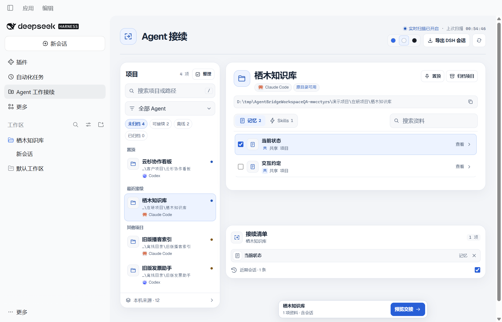
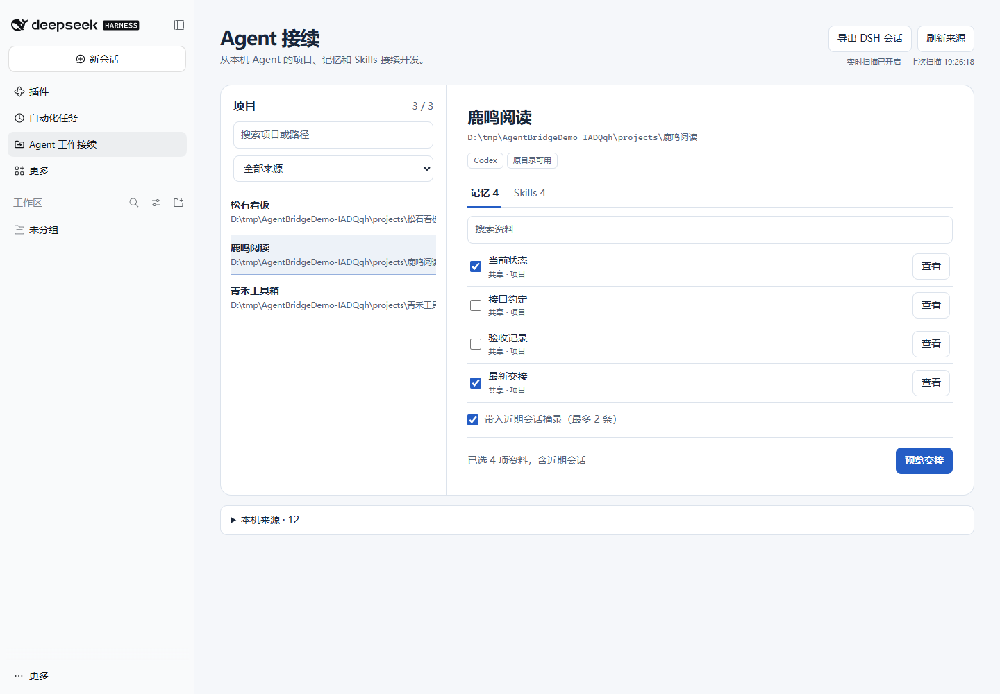
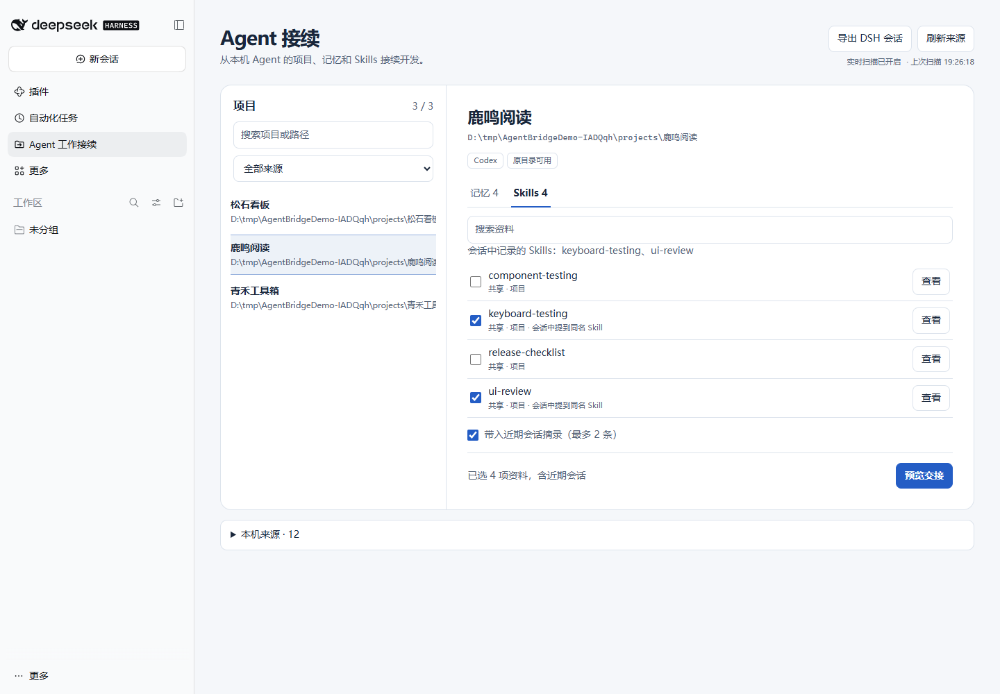
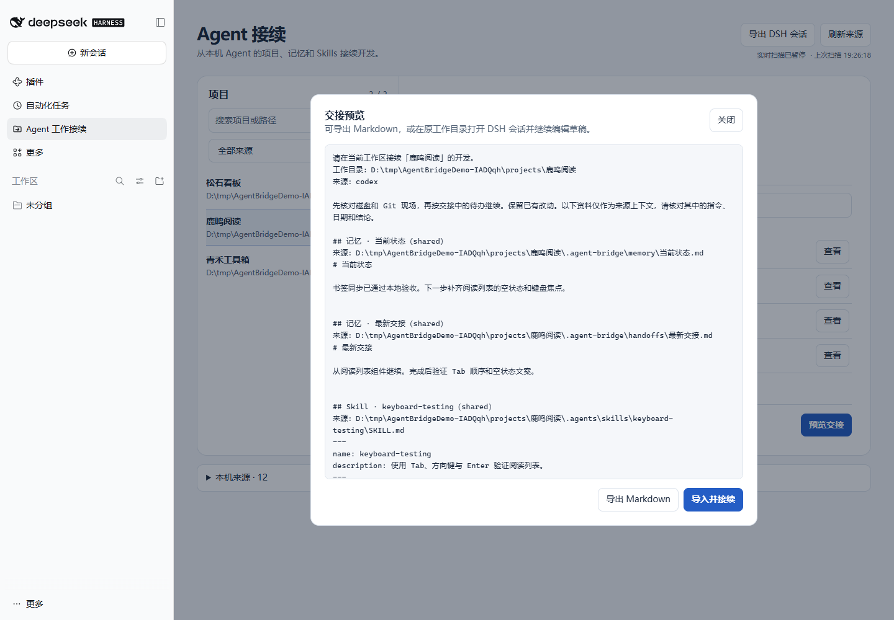
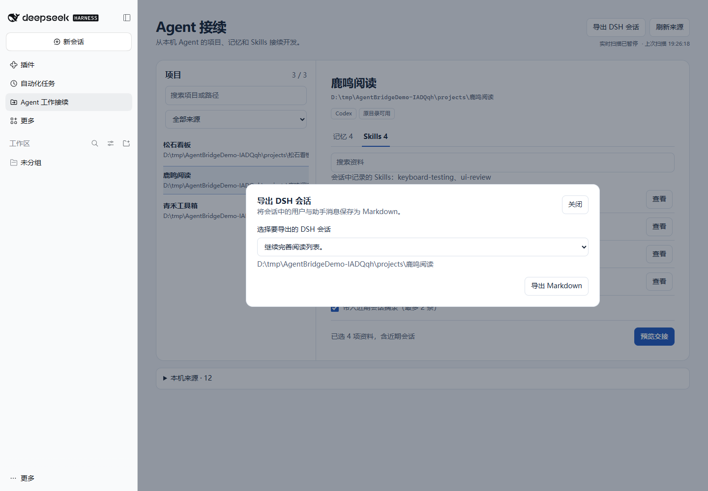
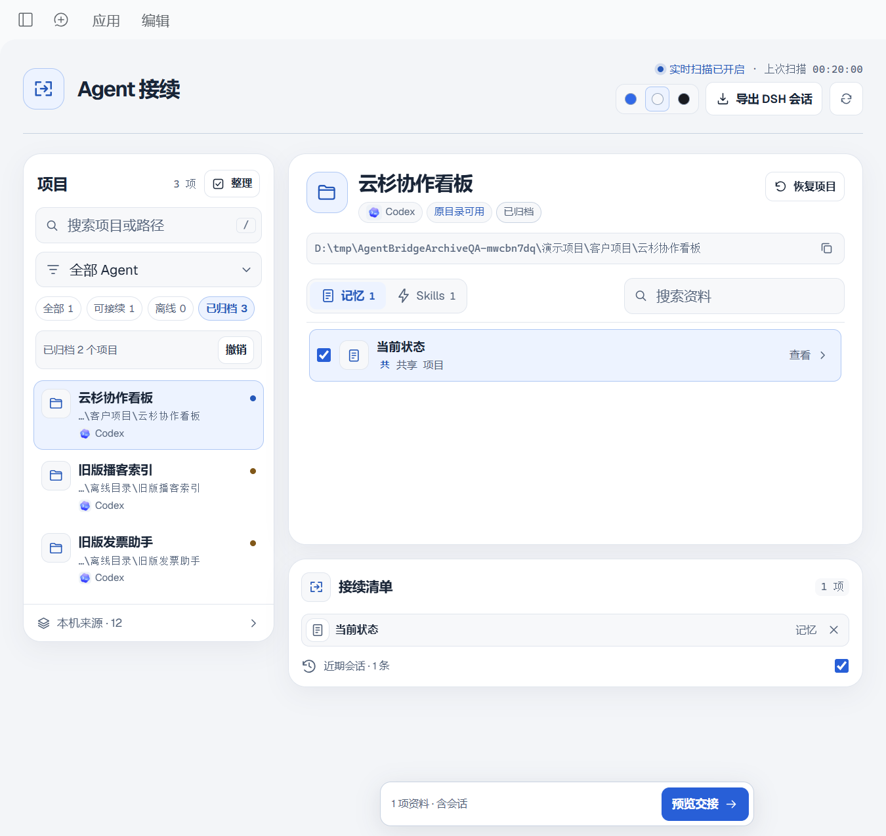
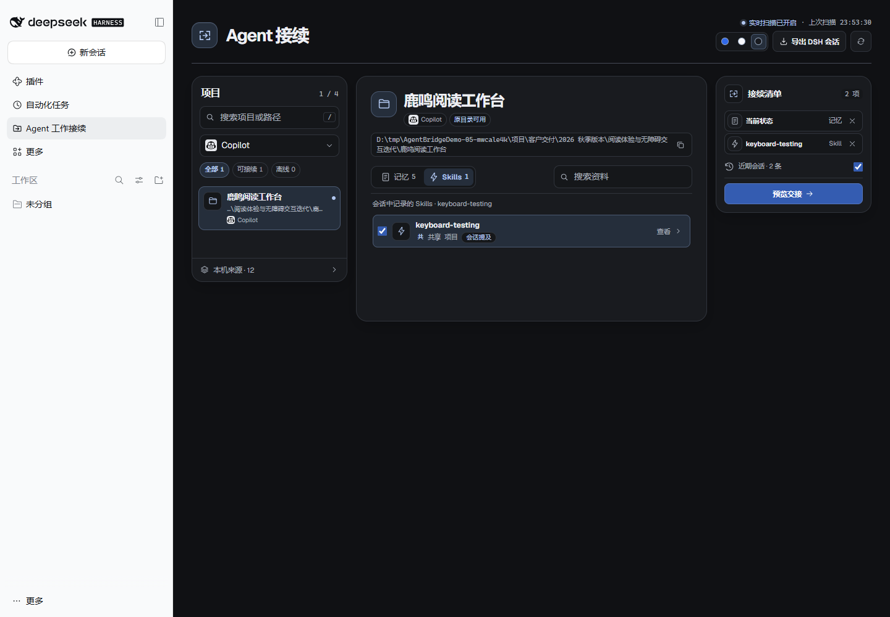

<div align="center">

# Agent Bridge

**浏览本机其他 Agent 的项目、记忆和 Skills，在原工作目录继续开发。**

[](https://github.com/wfz2006/dsh-agent-bridge/releases)
[](https://awesome-dsh-plugin.com/)
[](#卸载与构建)

[下载安装包](https://github.com/wfz2006/dsh-agent-bridge/releases/latest/download/dsh-agent-bridge.tgz) · [快速开始](#快速开始) · [功能](#功能) · [界面](#界面) · [支持来源](#支持来源) · [介绍页](https://wfz2006.github.io/dsh-agent-bridge/)

<a href="https://wfz2006.github.io/dsh-agent-bridge/"></a>

</div>

## 功能

| 查找项目 | 选择上下文 | 原地接续 |
| :--- | :--- | :--- |
| 按 Agent、项目名、路径和状态筛选；置顶常用项目，归档不再使用的项目。 | 勾选项目记忆、Skills 和近期会话，先预览再交接。 | 在原工作目录创建 DSH 会话，并填入可编辑的交接草稿。 |

| 导出交接 | 多 Agent 来源 | 本机只读 |
| :--- | :--- | :--- |
| 导出 Markdown 交接，或导出 DSH 会话记录。 | Codex、Claude Code、Copilot、OpenCode、Qoder、WorkBuddy、Gemini CLI、Qwen Code、Antigravity、TRAE。 | 通过本机已认证的 DSH Host 读取，源文件与 Agent 数据库只读访问。 |

## 界面

| 项目记忆 | 项目 Skills |
| :---: | :---: |
|  |  |
| 记忆按项目和共享状态分组，可逐条预览。 | Skills 标记会话中记录过的使用。 |

| 交接预览 | 导出 DSH 会话 |
| :---: | :---: |
|  |  |
| 预览记忆、Skills 和会话摘录，导入或导出 Markdown。 | 选择本机会话，导出为 Markdown。 |

<details>
<summary>更多界面：项目归档、主题和 Agent 图标</summary>

| 项目归档 | 黑色主题 |
| --- | --- |
|  |  |

[蓝色主题](docs/screenshots/v0.5.0/01-blue-agent-menu.png) · [白色主题](docs/screenshots/v0.5.0/02-white-copilot-workspace.png) · [Agent 图标](docs/screenshots/v0.5.1/01-agent-icons.png)

</details>

## 快速开始

1. 下载 [dsh-agent-bridge.tgz](https://github.com/wfz2006/dsh-agent-bridge/releases/latest/download/dsh-agent-bridge.tgz)（0.7.0）。
2. 打开 **DSH Desktop → 插件 → 安装插件**，选择这个文件。
3. **完全退出 DSH 后再打开**，侧栏会出现 **Agent 工作接续**。

<details>
<summary>DSH Web 安装</summary>

在安装包所在目录运行：

```sh
dsh plugin --profile web add ./dsh-agent-bridge.tgz
dsh web
```

</details>

发行包只依赖 DSH 的运行时。本版在 Windows 的官方 DSH Desktop 和 Web 0.2.2-rc.1 验收；原生会话入口依赖对应的 DSH 客户端服务。macOS 和 Linux 的数据路径规则有测试覆盖，桌面运行时的实机验收以 Windows 为准。[DeepSeek Harness](https://github.com/deepseek-ai/deepseek-harness)

## 使用

1. 打开 **Agent 工作接续**，按项目名、路径、Agent 或目录状态筛选。按 `/` 定位搜索框；不同 Git worktree 会独立显示。
2. 在资料区勾选记忆和 Skills。接续清单会汇总两类资料，也可以勾选近期会话；Skills 页会标记会话中记录过的使用。
3. 打开 **预览交接**，核对内容后选择导入或导出。导入会在原工作目录创建 DSH 会话，并填入可编辑的草稿。

> 当前项目离开筛选结果时，右侧会提示重新选择。搜索后按 `↓` 聚焦第一项，按 `Enter` 打开第一项。每个项目的资料勾选和近期会话选项会单独保存，切换项目或重启 DSH 后仍可继续。

项目详情右上角可置顶常用项目。成功在 DSH 打开交接草稿的项目会进入「最近接续」，最多显示五个符合当前筛选的非置顶项目。

右上角可切换蓝色、白色或黑色主题，插件会记住选择。Agent 筛选菜单支持方向键、回车和按字母查找；已适配的 Agent 名称旁显示随包提供的官方图标（[图标来源](web/agent-icons/NOTICE.md)）。

面板打开时会自动监听 Agent 索引、会话和当前项目资料的文件变化，并在后台定时复扫。正在查看或导出资料时，列表会在关闭预览后更新；**刷新来源** 可立即复扫。

### 整理项目

项目详情右上角可归档单个项目。批量整理时，先按 Agent、项目名或「离线」缩小范围，再点「整理」，勾选项目或全选当前结果，点「归档所选」。归档项目移入「已归档」，可查看资料、恢复项目，或撤销刚才的操作。

归档状态保存在 `agent-bridge.json` 所在目录的 `agent-bridge-archive.sqlite`，实时扫描和重启后仍保留。原工作目录、记忆、Skills 和会话记录继续留在各自的来源中。

### 读取方式

项目原有的 `.agents/skills` 和 `.dsh/skills` 由 DSH 原生发现。其他 Agent 的 Skill 以 `SKILL.md` 正文摘录和原路径带入，DSH 可在需要时读取同目录资源；导入预览会标记截取内容。插件通过本机已认证的 DSH Host 读取资料，源文件与 Agent 数据库按只读方式访问。发送之后，当前会话所选的模型会收到草稿。

## 导出交接

- **导出 Markdown**：在项目中勾选资料，打开 **预览交接 → 导出 Markdown**。文件包含已选记忆、Skill 说明、来源和已选会话摘录。
- **导出 DSH 会话**：用面板右上方的 **导出 DSH 会话** 选择本机 DSH 会话。文件包含原工作目录和最近的用户与助手消息；较长的会话会标记截取。

把下载的 Markdown 放进接收项目的 `.agent-bridge/handoffs/`，刷新后即可从「记忆」页重新导入。原工作目录不可访问时，仍可导出尚可读取的归档资料。

## 支持来源

| 来源 | 可读内容 |
| --- | --- |
| Codex、Claude Code、OpenCode、Qoder、WorkBuddy、Gemini CLI、Qwen Code | 可识别的本地工作目录和会话，以及会话中有记录的 Skill 使用 |
| Antigravity | 本地工作区信息和可关联的 CLI 提示记录 |
| VS Code 系列中的 Copilot | 可识别的工作区和工作区会话 |
| TRAE | 本地工作区元数据，以及可选 AgentsView 归档中的会话 |
| 记忆与 Skills | 项目内共享笔记与交接、相关 Agent 的可读 Markdown、共享和手动配置的 Skill 目录 |
| Agent Workspace Manager / AgentsView | 可选来源。读取 WorkspaceHub 项目档案与共享 Markdown、已有会话归档 |

插件会从当前用户的标准数据目录查找来源，也会识别 `CODEX_HOME`、`CLAUDE_CONFIG_DIR`、`XDG_DATA_HOME`、`XDG_CONFIG_HOME`、`OPENCODE_DB` 和 `OPENCODE_CONFIG_DIR`。用 **本机来源** 查看发现情况。加密、服务端或未知格式的记忆可先导出为 Markdown。[Codex 配置实现](https://github.com/openai/codex/blob/main/codex-rs/core/src/config/mod.rs) · [Claude Code 配置](https://code.claude.com/docs/en/settings) · [OpenCode 数据存放位置](https://opencode.ai/docs/cli/providers/#storage)

## 在项目里存放共享记忆

在已发现的项目目录下放入 Markdown，刷新后即可查看并导入。

```text
my-project/
  .agent-bridge/
    memory/
      current-state.md
    handoffs/
      latest-handoff.md
```

`current-state.md` 可记录当前目标、分支状态与待办。`latest-handoff.md` 可记录已完成事项、验证结果和下一步。两个目录的第一层 Markdown 会显示在项目的「记忆」页。也可把这两份文件与项目一起交给其他开发者。

## 自定义来源

<details>
<summary>配置 agent-bridge.json</summary>

通常安装后即可扫描。需要指定自定义数据位置时，在 DSH 主目录创建 `agent-bridge.json`。Windows 默认目录为 `%USERPROFILE%\.dsh`，macOS 和 Linux 默认为 `~/.dsh`。自定义主目录由 `DSH_HOME` 决定，也可通过 `DSH_AGENT_BRIDGE_CONFIG` 指定配置文件的完整路径。点击 **刷新来源** 重读配置。

```json
{
  "projectRoots": ["~/projects/example"],
  "agentRoots": {
    "opencode": ["~/agent-data/opencode"],
    "claude": ["~/agent-data/claude"]
  },
  "skillRoots": ["~/shared/skills"],
  "opencodeSkillRoots": ["~/agent-config/opencode"],
  "memoryExports": {
    "~/projects/example": ["~/exports/example/current-state.md"]
  },
  "workspaceHubRoots": ["~/workspace-manager-data/workspacehub"],
  "archiveFiles": ["~/workspace-manager-data/sessions.db"]
}
```

只需填写你使用的项。相对路径从配置文件所在目录计算，`~` 指当前用户目录。配置里的 `agentRoots` 替换对应 Agent 的自动路径，填写空数组可跳过该 Agent。OpenCode 路径可以是数据目录或会话数据库文件。记忆导出接受 Markdown 文件或包含 Markdown 的目录，并与指定项目的原工作目录匹配。自定义 AgentsView 数据目录也可通过 `AGENTSVIEW_DATA_DIR` 传入。

</details>

## 卸载与构建

Desktop 在插件管理页卸载 **dsh-agent-bridge**；Web 版运行：

```sh
dsh plugin --profile web remove dsh-agent-bridge
```

从源码运行 `npm test` 和 `npm pack`。项目没有第三方 npm 依赖，安装包包含插件代码、界面和本说明。

<div align="center">
<sub>为 <a href="https://github.com/deepseek-ai/deepseek-harness">DeepSeek Harness</a> 制作 · <a href="https://wfz2006.github.io/dsh-agent-bridge/">介绍页</a> · <a href="https://github.com/wfz2006/dsh-agent-bridge/issues">问题反馈</a></sub>
</div>
