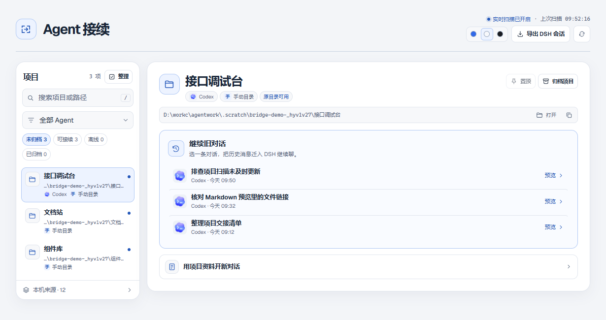
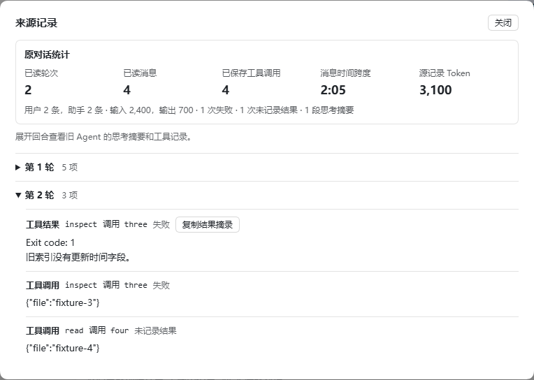
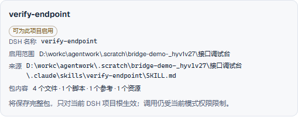
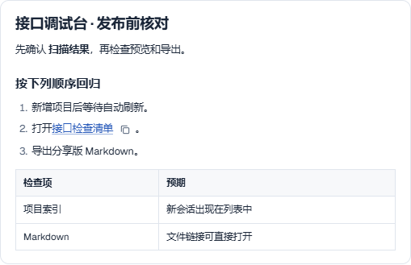

# Agent Bridge

**换个 Agent，接着做。**

把本机其他 Agent 的旧对话、项目记忆和 Skills 带进 DeepSeek Harness，在原工作目录继续开发。

[下载 Desktop 安装包](https://github.com/wfz2006/dsh-agent-bridge/releases/latest/download/dsh-agent-bridge.tgz) · [快速开始](#快速开始) · [看上手演示](#使用) · [图文介绍](https://wfz2006.github.io/dsh-agent-bridge/)

示例项目「接口调试台」 · v0.9.0 实际界面 · 点击查看大图

## 快速开始

### DSH Desktop

1. 下载 [GitHub 安装包 v0.9.0](https://github.com/wfz2006/dsh-agent-bridge/releases/latest/download/dsh-agent-bridge.tgz)。
2. 在 DSH 的 **插件 → 安装插件** 选择下载的 `.tgz`。
3. 完全退出再打开 DSH，从侧栏进入 **Agent 工作接续**。

### DSH Web

在已安装 DSH CLI 的环境里运行。当前 npm 版本为 [v0.9.0](https://www.npmjs.com/package/@wwwfz/dsh-agent-bridge)。

~~~sh
dsh plugin --profile web add @wwwfz/dsh-agent-bridge
dsh web
~~~

> [!NOTE]
> 下方演示的原对话统计、项目级原生 Skills 和新版 Markdown 预览来自 v0.9.0。

Windows DSH Desktop 0.2.2-rc.3 和 DSH Web 已完成隔离验收。原生会话和 Skills 需要宿主提供对应服务。macOS 和 Linux 的数据路径规则有测试覆盖。 [DeepSeek Harness](https://github.com/deepseek-ai/deepseek-harness)

## 使用

从侧栏打开 **Agent 工作接续**，按 Agent、项目名或路径找到原项目。不同 Git worktree 会独立显示。

### 继续旧对话

1. 在项目首屏点开一条最近对话，或用 **查看全部对话** 搜索。
2. 核对用户和助手的消息，再点 **迁入并继续**。
3. DSH 会在原工作目录打开一条带历史的新会话，输入下一句就能接着聊。

#### 在哪里看原对话统计

点新会话头部的 **来源记录**。顶部显示已读轮次、消息数和已保存的工具调用。原日志有足够的时间戳或累计 Token 时，也会显示相应数据。继续聊天后仍可查阅迁入时保存的统计。

*逐轮记录默认折叠。图中展开了第二轮，便于核对哪些工具失败或缺少结果。*

可迁入的历史范围

- 文字保留可读取的顺序和角色。较长历史按预算保留近期问答，预览会标记截取。Codex 的压缩会话 `.jsonl.zst` 也可发现和读取。
- 来源记录可保存 Codex 的可见思考摘要和工具调用，以及 Claude Code 的工具调用与结果。结果按调用 ID 归到原回合。历史工具数据以只读记录保存，后续请求按 DSH 当前权限执行。
- 宿主没有会话头部入口时，可在 Agent Bridge 的 **导出 DSH 会话** 中查看已保存的来源记录。旧版迁入的会话按当时保存的内容显示。

### 用项目资料开新对话

展开 **用项目资料开新对话**，从「上次做到哪」「项目约定」「Skills」等分组挑选资料。**全局资料库**默认折叠。打开 **接续清单** 可核对勾选，再用 **预览草稿** 打开一条新对话或导出交接。

#### 为本项目启用原生 Skill

看到 **可为此项目启用** 时，可点 **启用** 核对目标项目和包内容。在会话预览里也可以通过 **沿用技能（可选）** 勾选本次要带入的技能。在确认界面核对范围、脚本和同名冲突后，才会保存完整包。

*脚本、参考资料和资源随包保存。打开「已启用的项目 Skills」可管理和停用技能，有上一版时也可恢复。*

各类 Skill 状态和生效范围

- **DSH 已发现**表示当前项目能读到原生定义。入口的可用状态以实际生效副本和 DSH 调用策略为准。「待确认」「当前模式不可调用」表示当前检查结果。
- **可为此项目启用**表示可以为项目保存私有快照。快照位于 DSH 主目录的 `agent-bridge-skills/`，登记写入 `state.sqlite`。项目范围取最近的 `.git` 祖先，找不到时用原工作目录。
- **同名，待核对**时保留原技能，内容指纹一致才复用。预览后来源或项目位置改变，需要重新核对。
- **仅可带入说明**时使用 `SKILL.md` 正文摘录。指向包外的链接、包内特殊文件或疑似凭证文件会阻止整包启用。
- 启用确认的是快照和项目登记。执行脚本、使用专有工具、加载外部依赖仍取决于当前 DSH 环境。来源消失后，已有快照仍可管理。

## 导出交接

- **导出项目资料**。在 **预览草稿** 中选择 **导出本机版** 或 **导出分享版**。
- **导出 DSH 会话**。在面板右上角选择会话。需要工具名和结果摘录时，再勾选 **附带来源记录**。
- **接收一份交接**。把下载的 Markdown 放进接收项目的 `.agent-bridge/handoffs/`，刷新后从「上次做到哪」选用。

*预览可打开经过核对的项目内文件，也可以复制路径。*

本机版、分享版和路径规则

- 本机版将核实的本机来源写为 `file:` 链接，由阅读器决定能否打开。分享版使用文件名或项目相对路径，也可根据 Markdown 保存位置生成相对链接。
- 预览从原文档目录解析相对链接，Host 核对项目范围和文件身份后让 DSH 打开。脚本等可执行文件提供定位。失效路径以文字保留。Markdown 的标题、代码块、表格和引用会排版，原始 HTML 按文字展示。
- 原工作目录离线时，可导出仍能读取的归档资料。

## 支持来源

打开面板底部的 **本机来源** 查看可读取的数据。扫描会监听文件变化，也可点 **刷新来源** 立即复扫。

| 来源 | 常见可读取内容 |
| --- | --- |
| Codex、Claude Code、OpenCode、Qoder、WorkBuddy、Gemini CLI、Qwen Code | 本地工作目录和可识别的会话，含有记录的 Skill 使用 |
| VS Code 系列的 Copilot | 可识别的工作区和工作区会话 |
| Antigravity、TRAE | 本机工作区与可关联记录，另外可读配置的 AgentsView 归档 |
| 项目资料、WorkspaceHub、手动来源 | 可读 Markdown、共享记忆、交接和 Skill 目录 |

插件通过本机 DSH 所有者身份读取。源文件和 Agent 数据库以只读方式访问，加密或服务端记忆可先导出为 Markdown。

搜索、归档和主题

- 按 <kbd>/</kbd> 定位项目搜索，按 <kbd>↓</kbd> 选中首项，按 <kbd>Enter</kbd> 打开。项目的勾选和近期对话选项会分别保存。
- **置顶**常用项目。在 **最近接续** 可找回刚打开的项目。用 **整理 → 归档所选** 批量整理，在 **已归档** 恢复或撤销操作。
- 支持蓝、白、黑三套主题，自动记住选择。正在预览时，列表会等预览关闭后再更新。 [Agent 图标来源](web/agent-icons/NOTICE.md)

## 在项目里存放共享记忆

在已发现的项目目录里放入 Markdown，刷新后即可选择。

~~~text
my-project/
  .agent-bridge/
    memory/
      current-state.md
    handoffs/
      latest-handoff.md
~~~

用 `current-state.md` 记当前目标、分支状态与待办，用 `latest-handoff.md` 记已完成事项、验证结果和下一步。两个目录的第一层 Markdown 会进入项目资料。

## 自定义来源

配置 agent-bridge.json

在 DSH 主目录创建 `agent-bridge.json`。Windows 默认为 `%USERPROFILE%\.dsh`，macOS 和 Linux 默认为 `~/.dsh`。也可用 `DSH_HOME` 指定主目录，或用 `DSH_AGENT_BRIDGE_CONFIG` 指向配置文件。保存后点 **刷新来源**。

~~~json
{
  "projectRoots": ["~/projects/example"],
  "agentRoots": {
    "opencode": ["~/agent-data/opencode"],
    "claude": ["~/agent-data/claude"]
  },
  "skillRoots": ["~/shared/skills"],
  "opencodeSkillRoots": ["~/agent-config/opencode"],
  "memoryExports": {
    "~/projects/example": ["~/exports/example/current-state.md"]
  },
  "workspaceHubRoots": ["~/workspace-manager-data/workspacehub"],
  "archiveFiles": ["~/workspace-manager-data/sessions.db"]
}
~~~

只需填写要改的项。相对路径以配置所在目录为准。`agentRoots` 会替换对应 Agent 的自动路径，用空数组跳过该 Agent。OpenCode 可配置数据目录或数据库文件，AgentsView 也接受 `AGENTSVIEW_DATA_DIR`。

默认扫描会使用 `CODEX_HOME`、`CLAUDE_CONFIG_DIR`、`XDG_DATA_HOME`、`XDG_CONFIG_HOME`、`OPENCODE_DB` 和 `OPENCODE_CONFIG_DIR`。 [Claude Code 配置](https://code.claude.com/docs/en/settings) · [OpenCode 数据路径](https://opencode.ai/docs/cli/providers/#storage)

## 卸载与构建

在 Desktop 插件管理页卸载 **dsh-agent-bridge**。Web 版运行 `dsh plugin --profile web remove dsh-agent-bridge`。贡献者可从仓库目录运行 `npm test` 和 `npm pack`。 [第三方声明](THIRD_PARTY_NOTICES.md)

草稿失败时如何继续

初始化失败时，尚未使用的空白会话会归档，重试可复用原会话。若已有草稿，打开相同会话，可把接续资料补到已有内容里。

  <a href="https://wfz2006.github.io/dsh-agent-bridge/">项目介绍</a> ·
  <a href="https://github.com/wfz2006/dsh-agent-bridge/releases">历史版本</a> ·
  <a href="https://github.com/wfz2006/dsh-agent-bridge/issues">问题反馈</a>

