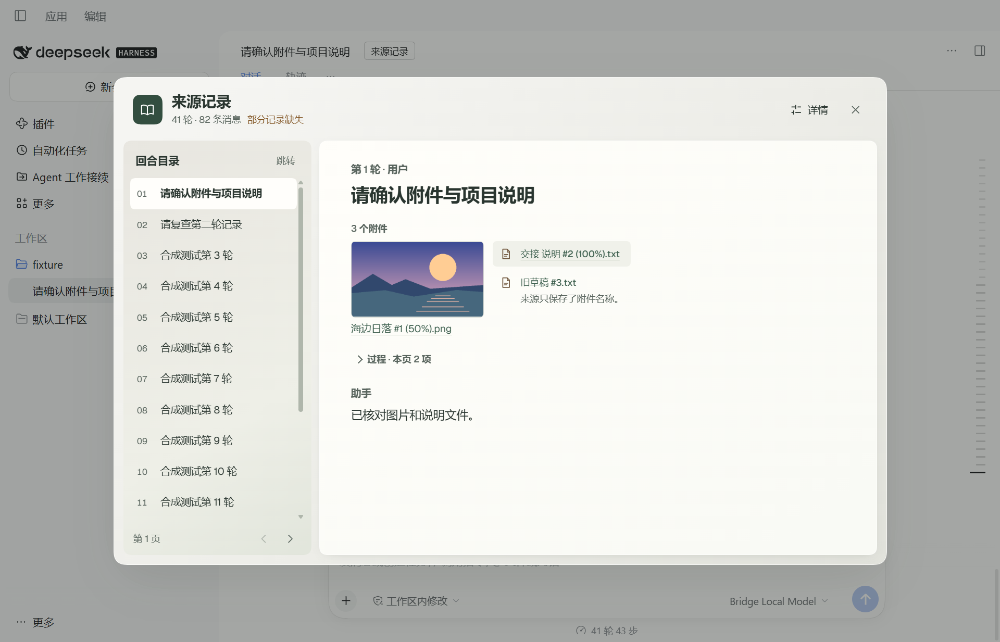

<div align="center">

# Agent Bridge

### 换个 Agent，接着做。

把本机其他 Agent 的对话、项目记忆和 Skills 带进 DeepSeek Harness，在熟悉的工作目录继续。

[下载 Desktop 插件](https://github.com/wfz2006/dsh-agent-bridge/releases/latest/download/dsh-agent-bridge.tgz) · [安装](#安装) · [使用指南](#使用) · [图文介绍](https://wfz2006.github.io/dsh-agent-bridge/)


</div>

## 这次更新

v0.10.0 重新整理了项目工作台和来源记录。迁入后可以在 DSH 原生对话中按原顺序查看正文、思考和工具过程，也可以通过来源记录按回合查看附件和原始信息。

- **继续旧对话**。预览后迁入，工具调用和结果关联到原回合，历史工具不会重新执行。
- **查看来源记录**。按回合浏览消息、过程和附件，图片可预览，已保存的文件可下载。
- **带上项目资料**。选择记忆、交接文档与 Skills，预览草稿后打开新会话。
- **启用项目 Skills**。核对技能包和目标项目后启用，脚本与参考资料随快照保存。
- **导出 Markdown**。本机版支持核验后的本机文件链接，分享版使用可读路径。代码围栏和原始空行得到保留。



## 安装

### DSH Desktop

1. 从 [GitHub Release](https://github.com/wfz2006/dsh-agent-bridge/releases/latest/download/dsh-agent-bridge.tgz) 下载 `dsh-agent-bridge.tgz`。
2. 在 DSH 中打开 **插件 → 安装插件**，选择下载的文件。
3. 完全退出并重新打开 DSH，在侧栏选择 **Agent 工作接续**。

### DSH Web

npm 当前发布版本为 v0.9.0。使用本仓库源码可构建 v0.10.0 安装包。

```sh
git clone https://github.com/wfz2006/dsh-agent-bridge.git
cd dsh-agent-bridge
npm install
npm pack
dsh plugin --profile web add ./wwwfz-dsh-agent-bridge-0.10.0.tgz
dsh web
```

## 使用

### 迁入旧对话

1. 在项目列表中按名称、路径或 Agent 查找项目。
2. 打开最近对话或查看全部对话，检查预览和来源记录。
3. 选择 **迁入并继续**。原目录离线时可选择新的本机目录。
4. 在 DSH 对话中查看消息和过程。打开会话头部的 **来源记录** 可按回合查看档案和附件。

续聊使用预览保留的近期问答正文。历史思考、工具与附件可在对话和来源记录中查阅，需要带入时可引用到草稿。

### 用项目资料开新对话

展开 **用项目资料开新对话**，选择项目记忆、交接或 Skills，点击 **预览草稿**。确认后打开新会话，草稿可在发送前编辑。启用原生 Skill 时，会先显示来源、项目范围和包内文件。

### 导出与接收交接

在草稿预览或 DSH 会话导出中选择本机版或分享版。接收项目可将交接 Markdown 放入 `.agent-bridge/handoffs/`，刷新后选择使用。

## 支持来源

可读取的本机来源包括 Codex、Claude Code、OpenCode、Qoder、WorkBuddy、Gemini CLI、Qwen Code 和 VS Code Copilot。Antigravity 与 TRAE 的部分工作区记录及配置的 AgentsView 档案也可发现。

不同来源保存的信息不同。预览会标出可读取的内容和缺失项，加密或服务端记忆可先导出为 Markdown。Windows DSH Desktop 0.2.2-rc.3 已做隔离实机验收，其他平台的路径规则有自动测试覆盖。

## 在项目里存放共享记忆

```text
my-project/
  .agent-bridge/
    memory/
      current-state.md
    handoffs/
      latest-handoff.md
```

刷新项目后即可选择第一层 Markdown 文件。


## 自定义来源

<details>
<summary>配置 agent-bridge.json</summary>

在 DSH 主目录创建 `agent-bridge.json`。Windows 默认为 `%USERPROFILE%\.dsh`，macOS 和 Linux 默认为 `~/.dsh`。也可用 `DSH_HOME` 指定主目录，或用 `DSH_AGENT_BRIDGE_CONFIG` 指向配置文件。保存后点 **刷新来源**。

~~~json
{
  "projectRoots": ["~/projects/example"],
  "agentRoots": {
    "opencode": ["~/agent-data/opencode"],
    "claude": ["~/agent-data/claude"]
  },
  "skillRoots": ["~/shared/skills"],
  "opencodeSkillRoots": ["~/agent-config/opencode"],
  "memoryExports": {
    "~/projects/example": ["~/exports/example/current-state.md"]
  },
  "workspaceHubRoots": ["~/workspace-manager-data/workspacehub"],
  "archiveFiles": ["~/workspace-manager-data/sessions.db"]
}
~~~

只需填写要改的项。相对路径以配置所在目录为准。`agentRoots` 会替换对应 Agent 的自动路径，用空数组跳过该 Agent。OpenCode 可配置数据目录或数据库文件，AgentsView 也接受 `AGENTSVIEW_DATA_DIR`。

默认扫描会使用 `CODEX_HOME`、`CLAUDE_CONFIG_DIR`、`XDG_DATA_HOME`、`XDG_CONFIG_HOME`、`OPENCODE_DB` 和 `OPENCODE_CONFIG_DIR`。 [Claude Code 配置](https://code.claude.com/docs/en/settings) · [OpenCode 数据路径](https://opencode.ai/docs/cli/providers/#storage)

</details>

## 卸载与构建

在 Desktop 插件管理页卸载 **dsh-agent-bridge**。Web 版运行 `dsh plugin --profile web remove dsh-agent-bridge`。贡献者可从仓库目录运行 `npm test` 和 `npm pack`。 [第三方声明](THIRD_PARTY_NOTICES.md)

<details>
<summary>草稿失败时如何继续</summary>

初始化失败时，尚未使用的空白会话会归档，重试可复用原会话。若已有草稿，打开相同会话，可把接续资料补到已有内容里。

</details>

<div align="center">
  <a href="https://wfz2006.github.io/dsh-agent-bridge/">项目介绍</a> ·
  <a href="https://github.com/wfz2006/dsh-agent-bridge/releases">历史版本</a> ·
  <a href="https://github.com/wfz2006/dsh-agent-bridge/issues">问题反馈</a>
</div>
